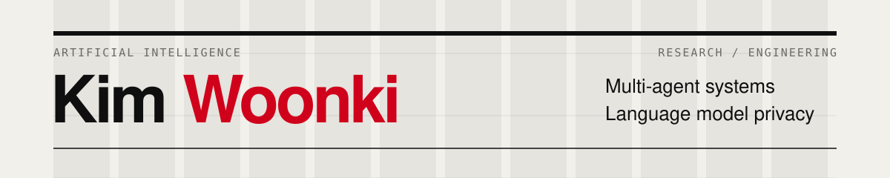
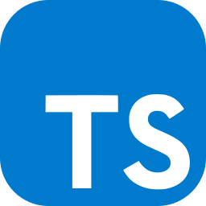

  <picture>
    <source media="(max-width: 600px)" srcset="./assets/editorial-header-mobile.svg" />
    
  </picture>

**M.S. in Artificial Intelligence · Oregon State University**

I build **multi-agent systems for retrieval and recommendation**, and study **language model privacy**. My work connects data pipelines, model training, orchestration, and application development.

[Selected work](#selected-work) &nbsp; / &nbsp; [Optimization & vision](#optimization--computer-vision) &nbsp; / &nbsp; [Methods & tools](#methods--tools) &nbsp; / &nbsp; [All repositories ↗](https://github.com/woonki94?tab=repositories)

## Selected work

### 01 / GrantMatchMaking Agent

**A LangGraph multi-agent system for matching researchers with funding opportunities.**

`Multi-Agent` `LangGraph` `RAG` `Cross-Encoder` `AWS Bedrock`

Natural-language requests are routed through a shared-state workflow that coordinates **faculty context, grant context, matching execution, and general conversation agents**.

- **Orchestration:** conditional routing for individual matches, team matches, and specific-grant evaluation; missing-information recovery and streaming node updates.
- **Retrieval & matching:** source-linked research keywords, embeddings, and fine-tuned cross-encoder scoring support recommendations and their explanations.
- **Application:** Flask streaming APIs, PostgreSQL + pgvector, S3, AWS Bedrock, and a React + TypeScript frontend.

**[Backend & setup ↗](https://github.com/woonki94/grant-matching-agent)** · [Agent orchestration ↗](https://github.com/woonki94/grant-matching-agent/blob/main/services/agent_v2/orchestrator.py) · [Frontend ↗](https://github.com/woonki94/grant-matching-agent-frontend)

### 02 / Data Extraction & Defense in LLMs

**Understanding memorization and defending against PII extraction.**

`GPT-2` `LoRA` `DP-SGD` `Opacus` `PyTorch`

Experiments with NanoGPT trained from scratch and GPT-2 Large fine-tuned with LoRA, comparing private and non-private training. The pipeline combines **DP-SGD, memory-efficient gradient clipping, extraction analysis, and generation-quality evaluation**.

**[Code & experiments ↗](https://github.com/woonki94/privacy-defense-gpt2)** · [Final report ↗](https://github.com/woonki94/privacy-defense-gpt2/blob/master/report/Data_Extraction_and_Defense.pdf)

## Optimization & computer vision

**[SCCA ↗](https://github.com/woonki94/SCCA)**  
Stochastic canonical correlation analysis with SVRG and shift-and-invert optimization.

**[SMRS ↗](https://github.com/woonki94/SMRS)**  
Sparse representative selection with ADMM, evaluated on synthetic data and Fashion-MNIST.

**[Convex Optimization for SVMs ↗](https://github.com/woonki94/ConvexOptimization-SVM)**  
Convex-hull classifiers with projected gradient descent, Nesterov acceleration, and ADMM.

**[Segment Style Transfer ↗](https://github.com/woonki94/Segment-Style-Transfer)**  
Segmentation-guided neural style transfer for images and video.

## Methods & tools

   &nbsp;
   &nbsp;
   &nbsp;
   &nbsp;
   &nbsp;
   &nbsp;
  

- **Agents & retrieval:** LangGraph, multi-agent orchestration, RAG, embeddings, cross-encoder reranking.
- **Model training & privacy:** PyTorch, Hugging Face Transformers, LoRA, knowledge distillation, Opacus / DP-SGD.
- **Application systems:** Python, Flask, SQLAlchemy, PostgreSQL, pgvector, AWS Bedrock / S3, React, TypeScript.
- **Optimization:** ADMM, variance reduction, convex optimization, MATLAB.

---

Design credits

Compact header adapted from [Awesome GitHub Profile — Swiss Grid](https://github.com/beydemirfurkan/awesome-github-profile/tree/main/templates/11-swiss-brutalist/swiss-grid). Icons from [Skill Icons](https://github.com/tandpfun/skill-icons). License notices are preserved in [vendor/awesome-github-profile/LICENSE](./vendor/awesome-github-profile/LICENSE) and [assets/icons/LICENSE](./assets/icons/LICENSE).

All descriptive content is native Markdown. See [design notes](./DESIGN.md) for customization.

