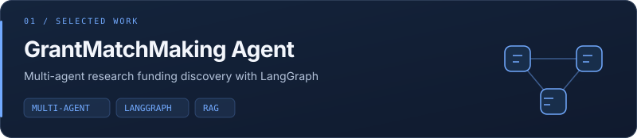
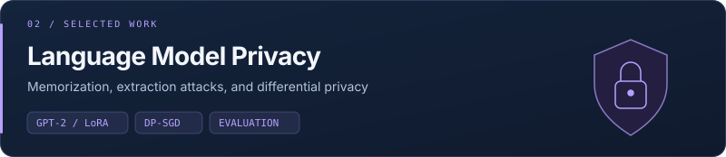
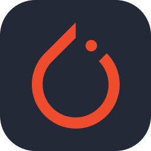

  <picture>
    <source media="(max-width: 600px)" srcset="https://raw.githubusercontent.com/woonki94/woonki94/profile-assets/neural-pulse-lattice-mobile.svg" />
    
  </picture>

  <a href="#selected-work">Selected work</a> &nbsp; · &nbsp;
  <a href="#optimization--computer-vision">Optimization &amp; vision</a> &nbsp; · &nbsp;
  <a href="#methods--tools">Methods &amp; tools</a> &nbsp; · &nbsp;
  <a href="#github-activity">Activity</a> &nbsp; · &nbsp;
  <a href="https://github.com/woonki94?tab=repositories">All repositories ↗</a>

**M.S. in Artificial Intelligence · Oregon State University**

I build **multi-agent retrieval and recommendation systems** and study how language models memorize training data. My projects span grant discovery, privacy-preserving training, numerical optimization, and computer vision.

## Selected work

<a href="https://github.com/woonki94/grant-matching-agent">
  <picture>
    <source media="(max-width: 600px)" srcset="./assets/project-grant-mobile.svg" />
    
  </picture>
</a>

**A LangGraph multi-agent system for matching researchers with funding opportunities.**

Natural-language requests are routed through a shared-state workflow that coordinates **faculty context, grant context, matching execution, and general conversation agents**.

- **Orchestration:** conditional routing for individual matches, team matches, and specific-grant evaluation; missing-information recovery and streaming node updates.
- **Retrieval & matching:** source-linked research keywords, embeddings, and fine-tuned cross-encoder scoring support recommendations and their explanations.
- **Application:** Flask streaming APIs, PostgreSQL + pgvector, S3, AWS Bedrock, and a React + TypeScript frontend.

**[Backend & setup ↗](https://github.com/woonki94/grant-matching-agent)** · [Agent orchestration ↗](https://github.com/woonki94/grant-matching-agent/blob/main/services/agent_v2/orchestrator.py) · [Frontend ↗](https://github.com/woonki94/grant-matching-agent-frontend)

 

<a href="https://github.com/woonki94/privacy-defense-gpt2">
  <picture>
    <source media="(max-width: 600px)" srcset="./assets/project-privacy-mobile.svg" />
    
  </picture>
</a>

Experiments with NanoGPT trained from scratch and GPT-2 Large fine-tuned with LoRA, comparing private and non-private training. The project includes DP-SGD, memory-efficient gradient clipping, extraction analysis, and generation-quality evaluation.

**[Code & experiment guide ↗](https://github.com/woonki94/privacy-defense-gpt2)** &nbsp; · &nbsp; [Final report ↗](https://github.com/woonki94/privacy-defense-gpt2/blob/master/report/Data_Extraction_and_Defense.pdf)

## Optimization & computer vision

| Project | Technical focus |
| :--- | :--- |
| **[SCCA ↗](https://github.com/woonki94/SCCA)** | Stochastic optimization for canonical correlation analysis using SVRG and shift-and-invert methods. |
| **[SMRS ↗](https://github.com/woonki94/SMRS)** | Sparse representative selection with ADMM; experiments on synthetic data and Fashion-MNIST. |
| **[Convex Optimization for SVMs ↗](https://github.com/woonki94/ConvexOptimization-SVM)** | Convex-hull classifiers with projected gradient descent, Nesterov acceleration, and ADMM. |
| **[Segment Style Transfer ↗](https://github.com/woonki94/Segment-Style-Transfer)** | Segmentation-guided neural style transfer for images and video. |

## Methods & tools

   &nbsp;
   &nbsp;
   &nbsp;
   &nbsp;
   &nbsp;
   &nbsp;
  

- **Language models:** PyTorch, Hugging Face Transformers, LoRA, Opacus / DP-SGD.
- **Agents & retrieval:** LangGraph, multi-agent orchestration, RAG, embeddings, cross-encoder reranking, PostgreSQL, pgvector, AWS Bedrock.
- **Applications & infrastructure:** Python, Flask, SQLAlchemy, AWS S3, React, TypeScript.
- **Optimization:** ADMM, variance reduction, convex optimization, MATLAB.

## GitHub activity

<picture>
  <source media="(max-width: 600px)" srcset="https://raw.githubusercontent.com/woonki94/woonki94/profile-assets/analytics-grid-mobile.svg" />
  
</picture>

[Daily refresh ↗](https://github.com/woonki94/woonki94/actions/workflows/profile-visuals.yml) · [Data snapshot ↗](https://github.com/woonki94/woonki94/blob/profile-assets/activity-summary.json)

### Contribution snake

<picture>
  <source media="(prefers-color-scheme: dark)" srcset="https://raw.githubusercontent.com/woonki94/woonki94/profile-assets/snake-dark.svg" />
  <source media="(prefers-color-scheme: light)" srcset="https://raw.githubusercontent.com/woonki94/woonki94/profile-assets/snake.svg" />
  
</picture>

 

<a href="https://github.com/woonki94?tab=repositories">
  <picture>
    <source media="(max-width: 600px)" srcset="./assets/footer-mobile.svg" />
    
  </picture>
</a>

Design credits

[Neural Pulse Lattice](https://github.com/beydemirfurkan/awesome-github-profile/tree/main/templates/09-avant-garde/neural-pulse-lattice), [Analytics Grid](https://github.com/beydemirfurkan/awesome-github-profile/tree/main/templates/05-dashboard/analytics-grid), and [Snake Eat Graph](https://github.com/beydemirfurkan/awesome-github-profile/tree/main/templates/04-gamified/snake-eat-graph) are adapted from Awesome GitHub Profile. The snake is generated with [Platane/snk](https://github.com/Platane/snk). The matching project cards and footer use the earlier navy palette; icons come from [Skill Icons](https://github.com/tandpfun/skill-icons).

Original templates and MIT notices are preserved under [vendor/awesome-github-profile/](./vendor/awesome-github-profile/) and [assets/icons/LICENSE](./assets/icons/LICENSE). The earlier RyMe renderers and their license remain in [vendor/ryme/](./vendor/ryme/).

The profile uses repository-hosted SVG assets. See [design notes](./DESIGN.md) for regeneration and customization.

