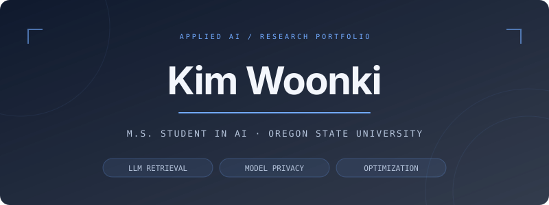
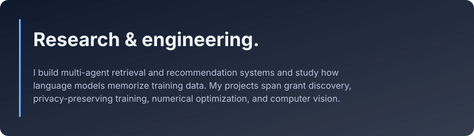

  <picture>
    <source media="(max-width: 600px)" srcset="./assets/header-mobile.svg" />
    
  </picture>

  <a href="#selected-work">Selected work</a> &nbsp; · &nbsp;
  <a href="#optimization--computer-vision">Optimization &amp; vision</a> &nbsp; · &nbsp;
  <a href="#methods--tools">Methods &amp; tools</a> &nbsp; · &nbsp;
  <a href="https://github.com/woonki94?tab=repositories">All repositories ↗</a>

  <picture>
    <source media="(max-width: 600px)" srcset="./assets/about-mobile.svg" />
    
  </picture>

## Selected work

<a href="https://github.com/woonki94/grant-matching-agent">
  <picture>
    <source media="(max-width: 600px)" srcset="./assets/project-grant-mobile.svg" />
    
  </picture>
</a>

A system for matching faculty research profiles with grant opportunities. The pipeline combines data ingestion, document extraction, keyword generation, embedding-based matching, reranking, and recommendation explanations.

- **System:** PostgreSQL + pgvector for structured data and embeddings, S3 for extracted content, and AWS Bedrock for model calls.
- **Application:** Flask APIs with streaming chat, collaborator discovery, and team recommendations; a separate React + TypeScript frontend.

**[Backend & setup guide ↗](https://github.com/woonki94/grant-matching-agent)** &nbsp; · &nbsp; [Frontend ↗](https://github.com/woonki94/grant-matching-agent-frontend)

 

<a href="https://github.com/woonki94/privacy-defense-gpt2">
  <picture>
    <source media="(max-width: 600px)" srcset="./assets/project-privacy-mobile.svg" />
    
  </picture>
</a>

Experiments with NanoGPT trained from scratch and GPT-2 Large fine-tuned with LoRA, comparing private and non-private training. The project includes DP-SGD, memory-efficient gradient clipping, extraction analysis, and generation-quality evaluation.

**[Code & experiment guide ↗](https://github.com/woonki94/privacy-defense-gpt2)** &nbsp; · &nbsp; [Final report ↗](https://github.com/woonki94/privacy-defense-gpt2/blob/master/report/Data_Extraction_and_Defense.pdf)

## Optimization & computer vision

| Project | Technical focus |
| :--- | :--- |
| **[SCCA ↗](https://github.com/woonki94/SCCA)** | Stochastic optimization for canonical correlation analysis using SVRG and shift-and-invert methods. |
| **[SMRS ↗](https://github.com/woonki94/SMRS)** | Sparse representative selection with ADMM; experiments on synthetic data and Fashion-MNIST. |
| **[Convex Optimization for SVMs ↗](https://github.com/woonki94/ConvexOptimization-SVM)** | Convex-hull classifiers with projected gradient descent, Nesterov acceleration, and ADMM. |
| **[Segment Style Transfer ↗](https://github.com/woonki94/Segment-Style-Transfer)** | Segmentation-guided neural style transfer for images and video. |

## Methods & tools

   &nbsp;
   &nbsp;
   &nbsp;
   &nbsp;
   &nbsp;
   &nbsp;
  

- **Language models:** PyTorch, Hugging Face Transformers, LoRA, Opacus / DP-SGD.
- **Retrieval & recommendations:** embeddings, cross-encoder reranking, PostgreSQL, pgvector, AWS Bedrock.
- **Applications & infrastructure:** Python, Flask, SQLAlchemy, AWS S3, React, TypeScript.
- **Optimization:** ADMM, variance reduction, convex optimization, MATLAB.

 

<a href="https://github.com/woonki94?tab=repositories">
  <picture>
    <source media="(max-width: 600px)" srcset="./assets/footer-mobile.svg" />
    
  </picture>
</a>

Design credits

Header and introduction adapted from [RyMe.md — Sleek](https://github.com/ryanpolasky/ryme.md). Technology icons from [Skill Icons](https://github.com/tandpfun/skill-icons). Both are used under the MIT license; notices are included in [vendor/ryme/LICENSE](./vendor/ryme/LICENSE) and [assets/icons/LICENSE](./assets/icons/LICENSE).

The profile uses repository-hosted SVG assets. See [design notes](./DESIGN.md) for regeneration and customization.

